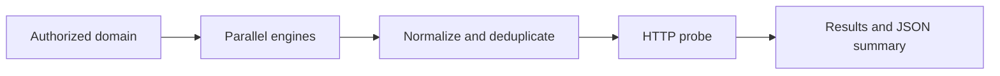

# Subdomreco

[](https://github.com/5r4z4/subdomreco/actions/workflows/ci.yml)
[](LICENSE)

Subdomreco is a Bash-based automation pipeline for passive subdomain reconnaissance. It runs multiple enumeration engines concurrently, normalizes and deduplicates their results, checks reachable web services, and stores reproducible per-target artifacts.

> Use Subdomreco only against assets you own or are explicitly authorized to test. Follow the target program's scope, rate limits, and rules of engagement.

## Why this project exists

Manual reconnaissance often produces inconsistent filenames, duplicated hosts, and results that are difficult to reproduce. Subdomreco provides one defensive-research workflow with validated inputs, isolated run directories, failure-tolerant engine execution, and machine-readable summaries.



## Features

- Parallel passive enumeration with Subfinder, Assetfinder, Amass, Findomain, and Sublist3r
- Domain validation and quoted arguments to prevent malformed input
- Graceful handling of optional or failed engines
- Target-scoped, timestamped output for repeatable investigations
- In-scope normalization and deterministic deduplication
- Optional live-host probing with ProjectDiscovery httpx
- JSON run summary suitable for automation and reporting
- Installer for the core Go-based toolchain
- ShellCheck and integration-test CI through GitHub Actions

## Quick start

```bash
git clone https://github.com/5r4z4/subdomreco.git
cd subdomreco
chmod +x subdomreco.sh scripts/install.sh

# Install Subfinder, Assetfinder, httpx, and Amass.
./subdomreco.sh --install

# Ensure the displayed install directory is in PATH, then scan an authorized target.
./subdomreco.sh --domain example.com
```

Findomain and Sublist3r are optional. If installed, Subdomreco detects and uses them automatically. Missing tools are reported and skipped.

## Usage

```text
./subdomreco.sh --domain DOMAIN [options]

  -d, --domain DOMAIN       Domain that you are authorized to assess
  -o, --output DIRECTORY   Output root (default: ./results)
  -e, --engines LIST       Comma-separated engine list
  -t, --threads NUMBER     httpx worker count (default: 50)
      --timeout SECONDS    httpx request timeout (default: 10)
      --skip-http          Enumerate only; do not probe hosts
      --install            Install the core toolchain and exit
  -h, --help               Show help
  -v, --version            Show version
```

Examples:

```bash
# Use two fast passive sources.
./subdomreco.sh -d example.com -e subfinder,assetfinder

# Enumerate without making HTTP requests to discovered hosts.
./subdomreco.sh -d example.com --skip-http

# Store output under a custom directory and reduce HTTP concurrency.
./subdomreco.sh -d example.com -o ./engagements -t 20
```

## Output

Each run is stored under `results/<target>/<UTC timestamp>/`:

```text
results/example_com/20260901T120000Z/
├── live_urls.txt
├── raw/
│   ├── amass.log
│   ├── amass.txt
│   ├── subfinder.log
│   └── subfinder.txt
├── subdomains.txt
└── summary.json
```

| Artifact | Purpose |
| --- | --- |
| `raw/*.txt` | Original output from each enumeration engine |
| `raw/*.log` | Diagnostic output for troubleshooting failed engines |
| `subdomains.txt` | Normalized, in-scope, deduplicated hostnames |
| `live_urls.txt` | URLs that responded to httpx probing |
| `summary.json` | Target, timestamp, tool version, and result counts |

## Development

The test suite replaces external reconnaissance tools with local mocks, so it does not contact real targets.

```bash
bash -n subdomreco.sh my_script.sh scripts/install.sh tests/test_cli.sh
shellcheck subdomreco.sh my_script.sh scripts/install.sh tests/test_cli.sh
bash tests/test_cli.sh
```

## CV-ready project description

**Subdomreco — Reconnaissance Automation Pipeline**  
Built a Bash automation pipeline that orchestrates five passive subdomain-enumeration tools in parallel, validates and normalizes target data, deduplicates results, probes reachable services, and produces structured run artifacts. Added fault isolation, CLI configuration, automated dependency setup, mock-based integration tests, ShellCheck, and GitHub Actions CI.

## License

[MIT](LICENSE)
